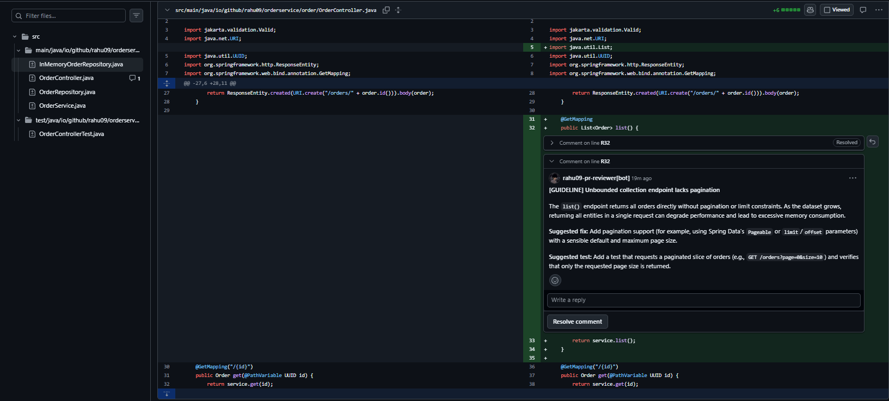
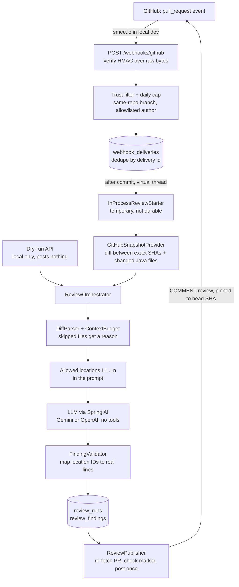

# AI PR Reviewer

A GitHub App written in **Java 25 + Spring Boot 4** that reviews small Java pull requests with an LLM, **validates every finding in Java**, and posts advisory inline comments as a bot.

> Personal portfolio project, built with AI assistance. Every design decision was recorded with its alternatives and trade-offs as it was made.

**Status: Sprint 1 done (v0.1).** Opening or updating a PR in the demo repo makes the bot post a review automatically. Retrieval from engineering guidelines, relevance ranking, evaluation numbers, Kafka and deployment are **planned, not built yet** (see [Roadmap](#roadmap)).

## What it looks like

A real review on a demo PR (`order-service-demo`), posted by the App's bot after a webhook, on the line where the unpaginated list endpoint starts:



The comment says what is wrong, suggests a fix and suggests a test. The review summary also lists the files reviewed, the files skipped and why, the model and prompt version, the reviewed commit, and that it is advisory and not a merge approval.

## How it works



The webhook and the dry-run API both call the **same** `ReviewOrchestrator`, so what is evaluated is what runs in production. The boxes are packages inside one Spring Boot app, not separate services. Code lives under `backend/src/main/java/io/github/rahu09/prreviewer/`, grouped by feature: `webhook`, `github`, `review` (the orchestrator, runs, API, fixtures), `context` (diff parsing, budget, locations), `ai`, `publishing`.

### Design rules that matter

- **The model never computes line numbers.** It picks a location ID (`L17`) from the list it was given, and Java maps that to the real file and line. An invented ID is suppressed and kept with its reason.
- **PR content is untrusted.** The model gets no tools and only returns data. Java performs every action. Model text is also neutralised before posting: `@` mentions are broken and a forged review marker cannot be written.
- **Every review is tied to one commit.** The diff is fetched between the exact base and head SHAs, so a push mid-review cannot change what is reviewed. If the head moves before posting, nothing is posted.
- **Publishing is idempotent.** Each review carries a hidden marker (`run`, `sha`, `config`). Before posting, the app looks for it on the PR. A repeated call, a webhook redelivery, or a request that timed out after GitHub accepted it posts no second review.
- **Webhooks are verified before anything else.** HMAC-SHA256 over the raw request bytes, constant-time comparison, `401` otherwise. Redeliveries are ignored by delivery id.
- **Only trusted PRs are reviewed**: same-repo branches by allowlisted authors, with a daily cap. The demo repo is public, so this keeps strangers from spending the LLM budget.
- **An empty review is a valid result.** No finding is forced out of a clean PR, and "no findings" never means "safe to merge".

## Run it locally

You need JDK 25, Docker, and Node.js (for the smee client). Secrets live in a git-ignored `.env` (copy [.env.example](.env.example); it lists names only).

```bash
cp .env.example .env            # then fill in the keys; paths use forward slashes
docker compose up -d            # Postgres (pgvector) on host port 5433
cd backend && ./mvnw spring-boot:run
```

**Try the engine without GitHub** (calls the LLM, posts nothing):

```bash
curl -s -X POST localhost:8080/api/dry-run/fixture/list-orders-unpaginated
```

**Review a real PR and post it** (needs a GitHub token or App, see below):

```bash
curl -s -X POST localhost:8080/api/dry-run/pr -H "Content-Type: application/json" \
  -d '{"owner":"<owner>","repo":"<repo>","number":1}'
curl -s -X POST localhost:8080/api/reviews/<runId>/publish
```

**Automatic reviews** need a GitHub App (Pull requests: read and write, Contents: read, event: Pull request) installed on the demo repo only, plus a smee.io channel forwarding to `http://localhost:8080/webhooks/github`. Put `GITHUB_APP_ID`, `GITHUB_APP_PRIVATE_KEY_PATH` (the App key converted to PKCS#8 with `openssl pkcs8 -topk8 -nocrypt`, kept outside the repo) and `GITHUB_WEBHOOK_SECRET` in `.env`; with an App id set, the app uses installation tokens instead of a personal token. The `/api/**` endpoints call a paid model and write to GitHub, so they must never be exposed publicly; only `/webhooks/github` and the health check are meant to be.

### Tests

```bash
cd backend && ./mvnw verify
```

The tests need Docker (Testcontainers starts Postgres) but **no network and no API keys**: the LLM and GitHub are stubbed or mocked, and CI has no keys. They cover the risky parts: diff-to-line mapping, finding validation, publish idempotency (twice, lost response, changed head, the 422 fallback), webhook signatures and redelivery.

## Tech

Java 25, Spring Boot 4, Spring Framework 7, Jackson 3, Spring AI 2 (Gemini or OpenAI, chosen by `LLM_PROVIDER`), PostgreSQL + Flyway, plain SQL with `JdbcClient` (no JPA), Testcontainers 2. Modern Java throughout: records for all data, sealed types with exhaustive `switch`, streams, virtual threads.

## Roadmap

| Step | What | State |
|---|---|---|
| Sprint 1 | Engine, GitHub read, publish, GitHub App + webhook, trusted-PR filter | **Done** |
| Sprint 2 | Guideline RAG (pgvector), Jev relevance ranking, first measured A/B/C results | Planned |
| Sprint 3 | Kafka with a transactional outbox, idempotent consumer, retries and a dead-letter topic (replaces today's in-process trigger) | Planned |
| Sprint 4 | Deployment with CI/CD, demo video, evaluation report | Planned |

**Known limits today:** the in-process review trigger is not durable (a crash mid-review loses that review; push a commit or reopen the PR to get another), and the daily cap can be overshot by a few reviews under a burst. Sprint 3 removes both.
