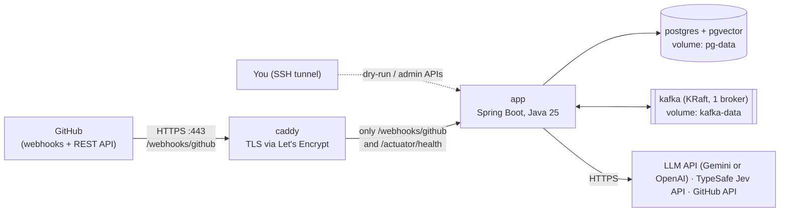

# Deployment plan

Decision record: [ADR-0015](decisions/0015-deployment-single-vm-compose-caddy-actions.md). This is a living runbook: update it whenever the deployment changes, and record big changes as ADRs.

**In one sentence:** GitHub Actions tests every push. Tagging a release builds a Docker image, pushes it to GitHub Container Registry, and deploys it over SSH to **one Linux VM**. On that VM, Docker Compose runs **Caddy (HTTPS) + the app + PostgreSQL/pgvector + Kafka**.

---

## 1. Environments

| Environment | Where | Purpose | What runs |
|---|---|---|---|
| **Local dev** | Your laptop, `E:\production\ai-pr-reviewer` | Build, debug, learn | `compose.yaml`: Postgres (pgvector) and Kafka (KRaft), plus Kafka UI (optional). The app runs from IntelliJ. Webhooks arrive through smee.io |
| **CI** | GitHub Actions runners | Test every push and PR | `./mvnw -B verify` in `backend/`. Testcontainers starts real Postgres and Kafka |
| **Production** | One Linux VM | The live GitHub App | `deploy/compose.prod.yaml`: caddy, app, postgres, kafka |

There is no separate staging environment, because there is one user and the demo repo is a safe target. After each deploy, the check is to open a test PR in `order-service-demo` and confirm the review appears.

## 2. Production topology



**Network rules**
- Public ports: **80 and 443** (Caddy only), plus **22** (SSH, key-only, ideally restricted to your IP).
- Postgres and Kafka publish **no ports** and are reachable only on the internal Docker network.
  - Gotcha: ports that Docker publishes bypass `ufw`, so the safe rule is simply not to publish them at all.
- Caddy forwards **only** `/webhooks/github` and `/actuator/health`. The dry-run, runs and admin endpoints call paid APIs, so they must never be public. Use them through `ssh -L 8080:localhost:8080 <vm>`.

## 3. Server sizing and host options

**Minimum: 2 vCPU, 4 GB RAM, 40 GB disk** (8 GB RAM is comfortable).

| Container | Memory budget | How |
|---|---|---|
| kafka | ~0.8 GB | `KAFKA_HEAP_OPTS=-Xms512m -Xmx512m` |
| postgres | ~0.5 GB | default settings are fine at this size |
| app | ~1.2 GB | container limit 1.2 GB, `-XX:MaxRAMPercentage=75` (includes the ONNX embedding model) |
| caddy | ~50 MB | |
| OS + Docker | ~0.5 GB | |
| **Total** | **~3 GB** | |

Host options (check current prices and terms again when you get to Chunk 14):
1. **Oracle Cloud Always Free (ARM / Ampere A1):** runs the **whole stack, Kafka included, for $0**. Sign up for the account at the Chunk 12 checkpoint and create the VM in Chunk 14. A VM created earlier would sit idle and could be reclaimed. It is **arm64**, so build the image for `linux/arm64` with `docker buildx`, and confirm that the ONNX runtime works on arm64 first. Details and caveats are in §3.1.
2. **A low-cost x86 VPS** (for example Contabo, Hetzner, DigitalOcean, Akamai/Linode or Vultr): usually a few dollars or euros a month and simple. The GitHub Student Developer Pack may include credits. **The cheapest one checked (2026-10-04):** Contabo Cloud VPS 4 (4 vCPU / 8 GB / 100 GB SSD) at €5.50/month + 18% GST ≈ **₹703** on a 1-month term, with no setup fee. The 12- and 24-month terms come to ≈ ₹597 and ₹563 a month. Hostinger KVM 2 (2 vCPU / 8 GB) is ₹799/month but only with 2 years paid upfront, and it renews at ₹1,199. When paying in euros with an Indian card, expect a forex markup and invoices you pay by hand.
3. Not recommended: the 1 GB "free tier" instances of the big clouds, which are too small for a JVM plus Kafka plus Postgres.

Record the choice and its monthly cost in an Addendum to ADR-0015.

### 3.1 Free hosting: what works and what doesn't (checked 2026-10-04)

**Why "free" is harder than it looks.** Removing Kafka is *not* what makes free hosting possible. Three other things decide it:
- **The app must be awake all the time.** GitHub waits only **10 seconds** for a webhook response and does **not** redeliver failed deliveries automatically. An app that sleeps and takes a minute to wake loses reviews.
- **Memory:** the JVM plus the local ONNX embedding model needs about 1 GB.
- **pgvector:** the database host must support it.

Also, **the LLM can be free too, on Gemini's free tier**, but only with synthetic demo code, because free-tier content is used to improve Google's products (ADR-0018). OpenAI is always paid. Keep the daily review cap either way.

| Option | Kafka? | Cost | Facts (from provider docs, 2026-10-04) | Catch |
|---|---|---|---|---|
| **Oracle Cloud Always Free A1 VM** | ✅ full stack | $0 | Up to 2 OCPUs and 12 GB RAM (1,500 OCPU-hours and 9,000 GB-hours per month), 200 GB block storage | Signup and A1 capacity can be hard. **Idle reclamation:** Oracle reclaims Always Free VMs if, over 7 days, **all three** are below 20%: CPU (95th percentile), network, and memory (A1 only). Size the VM to the stack (e.g. 2 OCPUs / 6 GB) rather than all 12 GB: about 3 GB used of 6 GB keeps memory near 50%, well above the line. Check the console metrics after the first week |
| **Render free web service + Neon free Postgres** | ❌ | $0 | Render sleeps after **15 min** without inbound traffic and wakes in about **1 min**; 750 free instance hours per month. Render's free Postgres **expires after 30 days** (then a 14-day grace period, then deletion). Neon free includes **pgvector**, 1 GB per project and **100 CU-hours per project per month**, and **suspends after 5 min** idle (this can't be turned off) | Only works with the design changes below. Check that the free instance's RAM can hold the JVM plus the ONNX model; if not, embeddings would have to move to an API (new ADR) |
| **Laptop + tunnel** | either | $0 | — | Fails "works with the laptop off" |
| **Low-cost VPS** | ✅ full stack | a few USD/EUR per month | — | None worth mentioning |

**The no-Kafka free fallback (Render + Neon), with the changes it needs.** Use this only if the Chunk 12 checkpoint decides it; it needs a new ADR that supersedes ADR-0014.
1. **Use the Postgres queue** (the ADR-0009 design) instead of Kafka. The v2 plan snapshot has its chunk card ("Durable jobs").
2. **Keep the app awake.** An uptime monitor pings it every ~10 min, so it never hits the 15-minute sleep; one always-on service uses about 730 of the 750 free hours. Ping `/actuator/health/liveness`, which does **not** touch the database, so the pings don't keep Neon awake.
3. **Don't poll the database every 2 s,** because that keeps Neon running around the clock and uses up the 100 CU-hours. Instead, start the review in-process (on a virtual thread) right after the webhook transaction commits, and run a **recovery sweep about once an hour** for jobs that were missed or got stuck.
4. **Use Neon, not Render's free Postgres,** because Render's free database expires after 30 days.

**The decision, at the Chunk 12 checkpoint:**

| Situation | Choice |
|---|---|
| You got the Oracle Always Free VM | Keep the plan as is: Kafka, Compose, Caddy, **$0** |
| No Oracle VM, but a few dollars a month is OK | Low-cost VPS, keep Kafka |
| No Oracle VM and it must be $0 | New ADR superseding ADR-0014: the Postgres queue on Render + Neon with the four changes above |

## 4. Domain and TLS
- Point a domain, or a free **DuckDNS** subdomain, at the VM's IP (an A record).
- Caddy obtains and renews Let's Encrypt certificates automatically. The `Caddyfile` is about 10 lines:

```
reviewer.example.com {
    @public path /webhooks/github /actuator/health
    handle @public {
        reverse_proxy app:8080
    }
    handle {
        respond 404
    }
}
```

## 5. Files added to the repo (Chunk 14)

```
ai-pr-reviewer/
├── Dockerfile                    runtime-only: eclipse-temurin:25-jre + the jar CI built, non-root user,
│                                 --enable-native-access=ALL-UNNAMED (ADR-0015 addendum)
├── deploy/
│   ├── compose.prod.yaml         caddy, app, postgres, kafka; named volumes; restart: unless-stopped; log rotation
│   ├── Caddyfile
│   ├── .env.example              names of every production variable (no values)
│   └── backup.sh                 pg_dump → gzip → keep 7 days
└── .github/workflows/
    ├── ci.yml                    from Chunk 1: verify on every push/PR
    └── deploy.yml                Chunk 14: build → push GHCR → SSH deploy → health check
```

The production image never contains secrets. GHCR images can stay public because the repo is public and the image holds no secrets.

## 6. CI/CD pipeline

**`ci.yml`** runs on every push and pull request:
1. Checkout, then `actions/setup-java` (Temurin 25, Maven cache).
2. `./mvnw -B verify` in `backend/`. Unit and integration tests run here, and Testcontainers uses the runner's Docker.
3. On failure, upload the test reports.

**`deploy.yml`** runs on a tag `v*` (for example `v0.3.0`) or manually:
1. Run the same verify step.
2. `./mvnw -B package` (the jar is built natively on the runner), then `docker buildx build --platform linux/amd64,linux/arm64` with the runtime-only Dockerfile. This only copies files, so the arm64 image for Oracle builds quickly under emulation. Push `ghcr.io/<lowercase-you>/ai-pr-reviewer:<git-sha>` and `:<tag>`. **Image names must be lowercase.** After the first push, check the package **visibility** in GitHub (make it public, or log in to GHCR on the server).
3. SSH to the VM. The SSH key, host and user are stored as **GitHub Actions secrets**. Then run:
   `cd /opt/ai-pr-reviewer && IMAGE_TAG=<git-sha> docker compose -f compose.prod.yaml pull app && IMAGE_TAG=<git-sha> docker compose -f compose.prod.yaml up -d app`
4. Health check: `curl --fail https://<domain>/actuator/health`, retried for about 60 s. If it never succeeds, the job fails and you roll back.

Deploy only on tags (one per milestone or chunk), not on every push to `main`. Releases stay deliberate, and every deployed version maps to a git tag.

## 7. First-time server setup (runbook, Chunk 14)

1. Create the VM (Ubuntu LTS) with your SSH public key. Disable password login, create a non-root `deploy` user and enable automatic security updates.
2. Firewall: allow 22 (your IP if possible), 80 and 443. Apply this in both the provider's firewall and `ufw`.
   - **On Oracle Cloud**, open 80/443 in the **VCN Security List** *and* in the instance's own **iptables** rules (Oracle's Ubuntu images block them by default), and persist the iptables rules (`netfilter-persistent save`).
3. Install Docker Engine and the Compose plugin, then add `deploy` to the `docker` group.
4. Create the DNS record pointing at the VM. **Wait until it resolves before starting Caddy**, because Let's Encrypt needs it and port 80.
5. In `/opt/ai-pr-reviewer/`, copy `compose.prod.yaml` and `Caddyfile`, create `.env` (`chmod 600`) and put the GitHub App private key at `secrets/github-app.pem` (`chmod 600`, mounted read-only).
6. Run `docker compose -f compose.prod.yaml up -d`.
   - **Flyway** runs the migrations at app startup.
   - **Kafka topics** are created at app startup (`NewTopic` beans).
7. Check `https://<domain>/actuator/health`.
8. In the GitHub App settings, set the webhook URL to `https://<domain>/webhooks/github`. Check the delivery log for the `ping` event.
9. Open a test PR in `order-service-demo`. The review should appear.
10. **Revoke the old PAT** if you haven't already (ADR-0010).

## 8. Secrets

| Secret | Where it lives |
|---|---|
| `LLM_PROVIDER`, `GEMINI_API_KEY` or `OPENAI_API_KEY`, `TYPESAFE_API_KEY` | VM `.env` (600) |
| `GITHUB_APP_ID`, `GITHUB_WEBHOOK_SECRET` | VM `.env` |
| GitHub App private key | VM `secrets/github-app.pem` (600, mounted read-only) |
| `POSTGRES_PASSWORD` | VM `.env` |
| SSH deploy key, host, user | GitHub Actions secrets |

Never put secrets in the repo, the image, logs or prompts. If one leaks, rotate it immediately and write down what happened in the chunk journal.

## 9. Database migrations and rollback
- Flyway runs on startup, and applied migrations are **never edited**.
- **Expand/contract rule:** each release's migrations must work with the *previous* app version. Add nullable columns or new tables; don't rename or drop in the same release; drop in a later release. That way a rollback is just running an older image.
- **Rollback:** `IMAGE_TAG=<previous-sha> docker compose -f compose.prod.yaml up -d app`. Keep the last 5 tags in GHCR.

## 10. Kafka in production
- One broker in KRaft mode, replication factor 1, 3 partitions, 7-day retention, data on the `kafka-data` volume.
- In production the app connects through Kafka's **internal listener** (`kafka:9092`) and to Postgres as `postgres:5432` (compose service names). The laptop-only external listener (`localhost:9094`) isn't exposed (pitfalls §9–§10).
- The ONNX embedding model cache (`spring.ai.embedding.transformer.cache.directory`) sits on its own volume, so restarts don't download the model again.
- **The source of truth is Postgres.** The outbox and `review_requests` tables hold everything. If Kafka loses data or is down, webhooks are still accepted, and the relay publishes once Kafka is back.
- There is no high availability. Real production would use 3 brokers (RF 3, `min.insync.replicas=2`) or managed Kafka (ADR-0014).
- To check consumer lag: `docker compose exec kafka /opt/kafka/bin/kafka-consumer-groups.sh --bootstrap-server localhost:9092 --describe --group pr-reviewer`

## 11. Backups and restore
- A nightly cron runs `backup.sh`: `docker compose exec -T postgres pg_dump …` → gzip → `/opt/ai-pr-reviewer/backups/`, kept for 7 days.
- Copy the backups off the server weekly, to your laptop (`scp`) or to object storage.
- Kafka is not backed up, because the events can be rebuilt from Postgres.
- **Rehearse a restore once** into a scratch database (this is part of Chunk 14's "Done when").

## 12. Monitoring and operations

| Concern | Approach |
|---|---|
| Up or down | An external uptime monitor (free tier) pings `/actuator/health` every 5 min and emails you |
| Logs | Spring Boot structured JSON logs with `runId`/`requestId` in the MDC. `docker compose logs -f app`. Docker log rotation (`max-size: 10m`, `max-file: 3`) |
| Metrics | Actuator and Micrometer counters: reviews succeeded/failed/superseded, DLT messages, LLM tokens, Jev fallbacks. Prometheus and Grafana are a stretch item (memory) |
| Kafka | Consumer lag (§10). Alert yourself if the DLT is non-empty |
| Cost | Spend limits in the LLM provider's console (OpenAI, or Gemini's paid tier) and in TypeSafe's, per-review caps, and `reviewer.limits.max-reviews-per-day` |
| Disk | `df -h` in the weekly checklist. Volumes: pg-data, kafka-data, backups |
| Updates | Ubuntu unattended-upgrades. Rebuild the image monthly to pick up JRE patches |

## 13. Cost estimate (verify in Chunk 14)

| Item | Expected |
|---|---|
| VM | Free (Oracle Always Free A1: 2 OCPUs / 12 GB) or a few USD/EUR per month for a VPS. The no-Kafka fallback on Render + Neon is also $0 (§3.1) |
| Domain | Free (DuckDNS) or about USD 10 a year |
| GitHub Actions and GHCR | Free for public repos |
| LLM API | **Gemini free tier: $0** (rate-limited; synthetic demo code only). OpenAI: small at demo volume, capped by a spend limit and the daily review cap |
| Jev API | Check TypeSafe pricing in Chunk 0 |

## 14. Chunk 14 "Done when" checklist
- [ ] With the laptop **off**, opening a PR in the demo repo produces a review.
- [ ] Deploying is: push a tag, the Actions workflow goes green, and the health check passes. No other manual steps.
- [ ] A rollback to the previous tag has been rehearsed once.
- [ ] A restore from backup has been rehearsed once.
- [ ] Postgres (5432) and Kafka (9092) are **not** reachable from the internet (test from your laptop).
- [ ] The dry-run and admin endpoints return 404 through the public URL.
- [ ] The uptime monitor is active, and ADR-0015's Addendum records the host and monthly cost.
